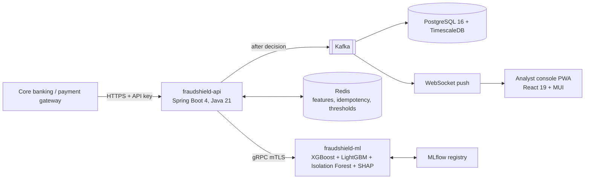

# FraudShield

Explainable fraud detection for East African digital payments (mobile money, USSD, agent banking,
cards, online and bank transfers across Rwanda, Kenya, Tanzania, Uganda and the DRC), and
**FraudShield-EAC**, the synthetic benchmark it is developed and evaluated on.

> **Everything here is synthetic.** FraudShield-EAC is generated by a seeded simulator. No row comes
> from a real customer, institution or regulator, and every result in this repository is a result on
> that synthetic benchmark. FraudShield is an independent research project; it is not deployed at,
> endorsed by, or validated with any financial institution or regulator. It is built by its sole
> author with AI coding agents, and has had no independent human review (the paper's disclosure
> section says what that means).

**The paper.** *FraudShield-EAC* reports what the benchmark can and cannot support:
[`docs/research/paper/`](docs/research/paper/). Every number in it is a macro audited against an
evidence file at a named commit, and CI builds the PDF on every push (the `paper` workflow's
`paper-pdf` artefact). Its open points are in
[`docs/research/paper/REVIEW.md`](docs/research/paper/REVIEW.md); quantitative claims about the
region are tracked, and mostly not verified, in
[`docs/research/claims_register.md`](docs/research/claims_register.md).

**Milestones.** Each milestone's state, open rows and decisions are recorded in
`docs/parallel/M*_updates.md` and its reviews in `docs/reviews/`. This README does not restate
results; the paper and the evidence files do, with their scale and the run that produced them.

## Regenerate the evaluation draw

The paper's results are on draw `d8083dbc`: one million requested rows at seed 20260917, generated
by the code at the tag `m4-complete`. The fingerprint is a SHA-256 over a fixed sample of rows per
table plus the row counts (`dataset/src/fraudshield_dataset/fingerprint.py`), so it identifies the
draw without hashing every row.

```bash
git worktree add ../fs-m4 m4-complete && cd ../fs-m4
uv sync --package fraudshield-dataset --package fraudshield-ml --locked
uv run fs-dataset generate --output out/bench1m --rows 1000000 --seed 20260917
uv run fs-dataset packs --output out/packs.json
uv run fs-dataset split out/bench1m --output out/split.json
uv run python -c "import sys; from pathlib import Path; \
  from fraudshield_dataset.fingerprint import dataset_fingerprint as f; print(f(Path(sys.argv[1])))" out/bench1m
# expect d8083dbc742c20437bf3d060614f88849059eb8cf12bd0d3bbb092b518e6be32
```

The `paper-reproduce` workflow
(`.github/workflows/paper-reproduce.yml`) does exactly this on a GitHub-hosted runner, checks the
fingerprint, rebuilds the feature caches, refits the gate model and the diagnostic battery, and
fails if a published headline does not reproduce.

## Reproduce a table

[`docs/research/paper/reproduce_tables.md`](docs/research/paper/reproduce_tables.md) lists, for
every table in the paper, the evidence files its numbers come from and the command each file
records. It is generated from the paper's own tables and the audit's sources, and CI fails if it is
out of date. Model results follow a fixed chain on the regenerated draw: build a feature cache with
`fs-features evaluate … --cache`, then run the command recorded for the table (`gate`, `battery`,
`frontier`, … of the same CLI) on that cache. Scoring runs on the test period are logged in
`docs/benchmarks/test_set_access.jsonl`; runs made before the log existed, and one read made for the
paper that was not logged at the time, were back-filled and are marked so.

## What it is designed for

The specification targets payments that card-based fraud detection does not describe directly:
USSD transactions from feature phones carry no device fingerprint (resolution D-04), agent
cash-in and cash-out has no card equivalent, and EAC cross-border corridors are regional. It
specifies a synchronous decision path within a latency budget, an explanation for every flagged
transaction, and an analyst console for low-end Android devices. Which of these exist, and what has
been measured, is recorded per milestone; the analyst console is on a separate branch and is not
part of the paper's release. Quantitative claims about the regional fraud landscape in the
requirements are tracked in [`docs/research/claims_register.md`](docs/research/claims_register.md)
and are not repeated here.

## Planned architecture



Synchronous decision path with an asynchronous durability path; full design in the build
specification (`docs/prompts/`) and ADRs (`docs/adr/`).

## Repository map

| Path | Contents |
|---|---|
| `backend/` | Spring Boot services (Maven multi-module) — `common` money/currency primitives today |
| `ml/` | Python ML package (`ml/src/fraudshield_ml`) — operating-point analysis today |
| `frontend/` | Staff console — WCAG contrast utilities today |
| `tools/` | Governance tooling: defect register, traceability matrix, scope guard |
| `docs/srs/` | Requirements (SRS v1.0) and the binding defect register |
| `docs/adr/` | Architecture decision records |
| `dataset/` | Synthetic dataset generator, realism and anti-leakage checks, release export |
| `docs/traceability/` | Requirements ↔ tests ↔ evidence |
| `docker-compose.yml` | Local stack: Kafka, PostgreSQL + TimescaleDB, PII vault, Redis, MLflow, fakes |

## Dataset

`dataset/` generates **FraudShield-EAC-Transactions**: 24 months of transactions, labels and
account events across five countries, as partitioned Parquet with a CSV copy at export. It is
synthetic. Nothing in it comes from a real customer or a real institution, and results measured on
it are results on a synthetic benchmark (D-08).

```console
$ uv run fs-dataset generate --rows 1000000 --seed 20260917 --output /tmp/fs
$ uv run fs-dataset report /tmp/fs --rows 1000000 --seed 20260917
```

**The smallest run that contains the whole dataset is about 170,000 rows.** Below that the
mule-account role pool is usually empty, so a smaller run would hold seven of the eight fraud
scenarios. The generator refuses such a run and names the size that would work. Pass
`--allow-missing-scenarios` to generate anyway for development; the scenarios that could not be
staged are then recorded in `manifest.json` under `scenarios_not_staged`, so a deficient dataset
says so about itself. See the datasheet for how the figure is derived.

The realism and anti-leakage figures of the evaluation draw are in `dataset/realism_report.md`
(read at `m4-complete`) and summarised, with their sources, in the paper's dataset section; the
dataset is described in `docs/ml/datasheet.md`. The specification's release scale has not been run
(ML-DATA-01 is `VERIFIED_AT_REDUCED_SCALE`).

## Quickstart (development)

There are two supported environments (ADR 0010).

### Option A — GitHub Codespaces (full stack, Docker included)

Recommended for anything that needs Docker: the compose stack, Testcontainers, database security,
integration and chaos suites.

1. On the repository page on GitHub, choose **Code → Codespaces → ⋯ → New with options…**.
2. Select the branch, and a machine type with **4 cores and 16 GB RAM** (the devcontainer declares
   this as its minimum).
3. Wait for creation. `.devcontainer/post-create.sh` installs the pinned toolchains (checksum-
   verified), all locked dependencies and the git hooks, then runs `REQUIRE_DOCKER=1 make ci`,
   which includes starting the core stack and its smoke test. Its output is in the creation log.
4. In the Codespaces terminal:

```bash
make up            # core stack; waits until every service is healthy
make smoke         # functional checks: TimescaleDB, Redis, Kafka, S3 bucket, MLflow artifact
make ps            # status; MLflow on port 5000, Mailpit on 8025 (see the Ports tab)
make down          # stop (volumes kept)
```

### Option B — a local machine without Docker

Everything that does not need Docker runs locally: unit tests, lint, type checks, governance,
licence checks, and later feature code and reduced-scale ML training.

Prerequisites (exact versions in `.tool-versions`): Java 21, `uv`, Node 24 with `pnpm`. The
Docker CLI is used only to validate `docker-compose.yml`; no daemon is needed.

```bash
make bootstrap     # locked Python, Node and Maven dependencies; pre-commit hooks
make ci            # all checks; Docker suites print "SKIPPED: … requires Docker, verified in CI"
```

Docker-dependent suites never skip silently: CI runs them on every push with `REQUIRE_DOCKER=1`,
which turns a missing Docker daemon into a failure. `make up` generates a git-ignored `.env` with
random local credentials on first run. The stack is for **synthetic data only**.

Performance numbers are never taken from CI runners; see `docs/benchmarks/hardware.md`.

## Governance

- Every requirement, SRS table row and defect resolution has a row in
  [`docs/traceability/requirements_matrix.md`](docs/traceability/requirements_matrix.md);
  tests link to rows by tag. CI fails on unknown tags, on completed rows whose evidence is not an
  existing path, commit or CI run, on deviations that are not existing ADRs, and on requirement
  rows that differ from the SRS-derived seed (ADR 0004).
- Deviations from the SRS are recorded in [`docs/srs/defect_register.md`](docs/srs/defect_register.md)
  and `docs/adr/`.
- Milestone reviews are recorded in `docs/reviews/`.

## Licence and citation

- **Code:** Apache-2.0 ([`LICENSE`](LICENSE)).
- **Dataset** (FraudShield-EAC, as released by `dataset/release/`): CC BY 4.0
  ([`dataset/release/LICENSE-CC-BY-4.0.txt`](dataset/release/LICENSE-CC-BY-4.0.txt)).
- **Citation metadata:** `CITATION.cff` (no DOI has been issued yet).
